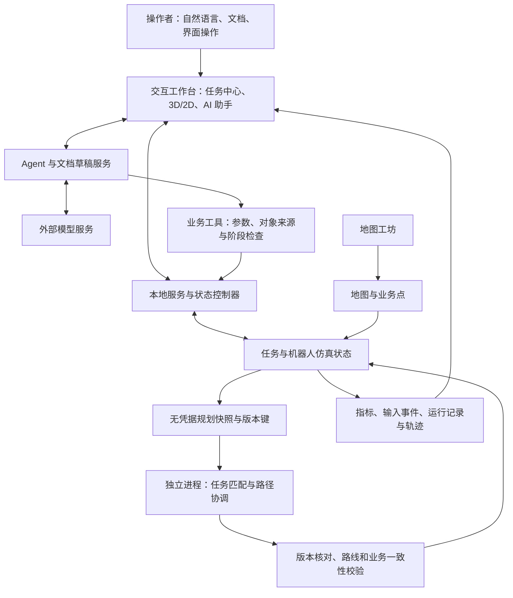
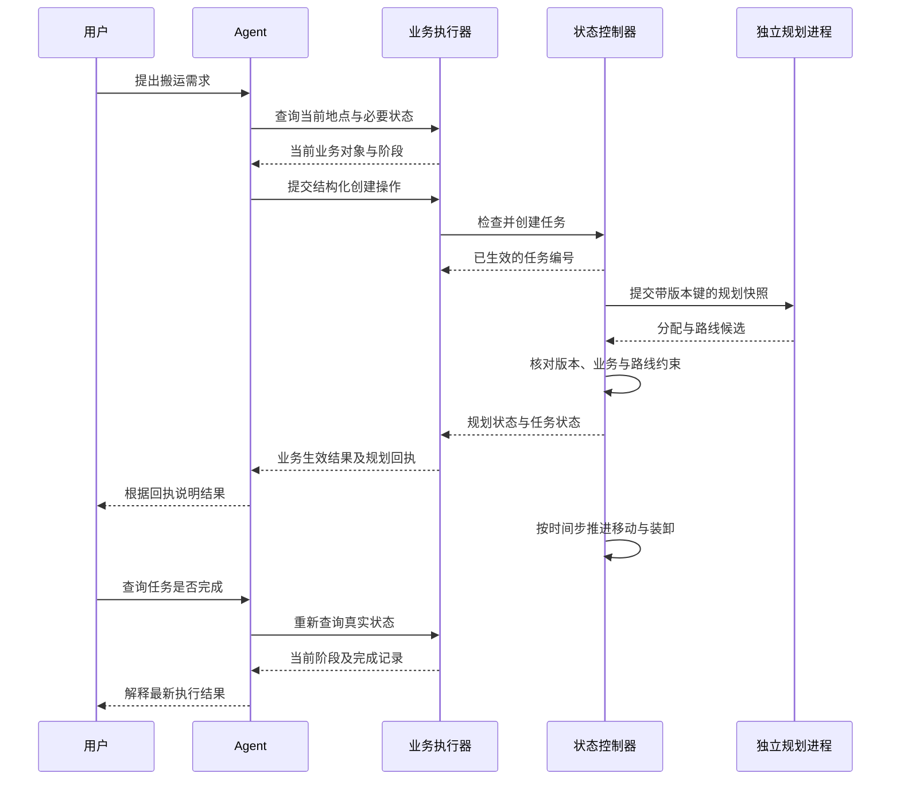
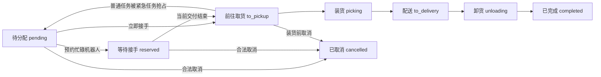
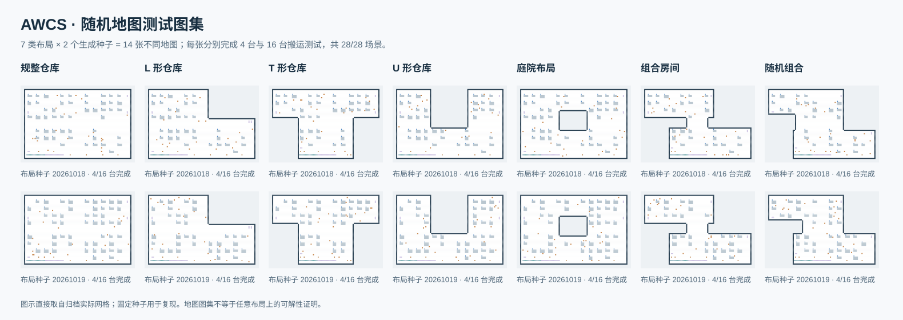

# 面向仓储搬运的智能体辅助多机器人协同调度系统研究

## ——AWCS 的设计、实现与实验分析

**项目名称：** AWCS · 智能仓储协同调度系统（Agent-Assisted Warehouse Coordination System）  
**项目标识版本：** v0.4_preview  
**文稿版本：** Markdown 预览稿 v1.0  
**编制日期：** 2026 年 10 月 22 日（香港时间）

> 本报告依据 AWCS 当前实现、2026 年 10 月 20—22 日已有测试及公开一手资料编写。算法、Agent 原测试、D07 修复专项分别对应各自记录版本；文中的当前设计说明不追溯改变历史成绩。具体证据入口见附录 A。

## 摘要

仓储搬运需要将人员提出的业务需求转换为明确任务，并在机器人状态、任务优先级和共享通道等约束下组织执行。业务指令理解、任务分配和路径规划分别正确，仍不足以保证完整流程中的对象选择、状态更新与实际执行保持一致。针对这一问题，本项目设计并实现 AWCS 智能仓储协同调度仿真系统，研究自然语言业务接入与确定性多机器人调度的连接方法。

系统以受约束的业务工具连接智能体与真实仿真状态，以分层目标和匈牙利匹配处理任务等级、人工指定及机器人软偏好，以安全区间搜索、时空预约和局部冲突修复协调机器人取货、装卸、配送和停车。规划在独立进程中执行，经状态版本核对与独立路线校验后提交。系统同时提供文档任务草稿、人工确认、3D/2D 同步展示、地图生成和运行记录，为实验分析提供可观察的环境。

已有测试显示，在对应版本与输入下，1,715 项任务分配、路径规划及执行保护核心检查和另行开展的 25 项回归检查通过；14 张生成地图的 4/16 台机器人主场景共 28/28 完成。单次规划预算为 3 秒时，32 台规模场景完成 5/8，16 台有限动态任务流完成 1/3，其余场景安全停止。50 份轨迹、16,634 个实际执行时间步的复审未发现所检约束违规。Agent 原主矩阵已执行 157/180 段，结果为 146 通过、10 失败、1 未完成；针对其中 D07 模糊指代取消问题，增加执行前目标来源校验，并在新批次中完成三轮真实模型定向复测，模糊指令均澄清且无写入，明确编号和界面关联取消均生效。

研究表明，业务规则显式化、模型决策与确定性执行分工、规划结果独立检查能够支撑可追踪的仓储协同仿真；扩大规模与持续任务流的完成能力、Agent 状态表述及文档约束归类仍需完善。现有证据支持有限场景下的方法与系统可行性，尚不构成新版本整体通过验收、生产部署效果或任意任务流下全局最优的证明。

**关键词：** 智能仓储；多机器人协同；任务分配；多智能体路径规划；安全区间搜索；工具调用智能体

## 目录

1. 研究背景与目标
2. 相关方法与问题建模
3. 系统总体方案与功能设计
4. 核心方法与实现
5. 实验设计与评价方法
6. 实验结果与讨论
7. 结论与展望
8. 参考文献
9. 附录：证据与源码索引

## 1 研究背景与目标

### 1.1 现有系统已经具备哪些能力

仓储自动化已有业务管理、机器人调度和设备接口等不同层面的技术积累。以 SAP Extended Warehouse Management 为例，其公开文档已说明仓库订单和任务读取、机器人资源分配、执行状态更新与完工确认等集成能力。这表明业务系统与机器人执行之间已有成熟的结构化连接方式。[SAP 官方集成说明](https://help.sap.com/docs/SAP_S4HANA_ON-PREMISE/f5d3e1005efd4e86acf9a65abf428082/94845e6639434e2dbc23f01098fed567.html?version=2022.000)

机器人侧同样存在跨车队管理与通信标准化工作。Open-RMF 将自身定位为多车队机器人管理平台；VDA 5050 则定义车队控制与移动机器人之间的通信接口，支持不同制造商设备的数据交换。此类系统关注设备接入、任务执行和协同管理，为真实工程提供基础。[Open-RMF 官方仓库](https://github.com/open-rmf/rmf)、[VDA 官方介绍](https://www.vda.de/en/press/press-releases/2026/260421_PM_VDA_5050_EN)

在算法研究中，任务匹配、多智能体路径规划及持续任务协调已有大量成果。CBS、SIPP 和 RHCR 分别提供冲突分解、安全时间区间表示和滚动协调等思路。已有工作的存在，决定了本项目应明确说明采用了哪些方法、作了哪些场景适配，以及哪些效果得到本项目自己的实验支持，而不能将基本算法作为原创成果。

### 1.2 本项目面对的需求与设计动机

已有系统能力并不自动解决本项目面向的所有问题。AWCS 关注的是一个可在本地演示、检查和试验的完整流程：人员以自然语言或文档表达搬运需求，系统将其转为结构化任务，多台机器人完成协同搬运，操作者能够追踪结果并分析失败原因。

这一流程有四项具体需求。

第一，**将灵活表达转为可检查的业务对象**。临时指令可能使用货架别名、模糊指代和数量描述；文档还可能混合历史事项、示例及未支持条件。系统需要查询当前地点映射、保留来源并对缺失信息澄清，不能仅凭生成一段自然流畅的回答判定需求已被执行。

第二，**使分配结果服从业务约束**。最近的机器人未必是应当接单的机器人。紧急任务、人工指定和软偏好应具有清楚的约束顺序；机器人开始装货后，还涉及装卸连续性和货物归属，不能随意中断或改派。

第三，**把通道共享问题纳入时间协调**。机器人分别拥有空间最短路，并不意味着它们可以同时执行这些路线。交叉口相遇、窄通道对向通行、作业点驻留和停车占用都需要结合时间检查。

第四，**让系统效果能够被复核**。界面动画可以展示流程，却无法独立证明匹配结果、业务授权和路线执行正确。系统需要保存输入、版本、规划记录和实际轨迹，将“任务创建成功”“路线可执行”和“最终交付完成”分别记录。

以上是结合项目目标提出的工程需求分析，并非对全部商业系统的缺陷判断。项目未开展真实仓库访谈、生产对照或采购成本调查，因此不据此宣称现有产品普遍缺少上述能力。AWCS 的设计动机是以可控制的仿真环境连接这些环节，研究它们在统一状态和业务约束下如何协作。

**表 1　现有技术基础与 AWCS 的研究切入点**

| 技术基础 | 已有能力或研究重点 | AWCS 重点处理的问题 |
| --- | --- | --- |
| 仓储业务管理系统 | 结构化订单、任务、资源及状态管理 | 自然语言和文档如何映射为当前场景中的明确任务 |
| 机器人车队管理与接口 | 多车队管理、设备通信和执行协同 | 在简化环境中显式展示业务约束到调度执行的关系 |
| 匹配与 MAPF 方法 | 给定目标下的任务匹配与无冲突路径搜索 | 加入取送阶段、装卸驻留、任务等级和人工作业意图 |
| 工具调用智能体 | 查询外部状态并提出操作 | 约束对象来源、校验真实副作用、根据回执解释结果 |

### 1.3 研究目标与问题

本项目的总体目标是建立一套智能体辅助的仓储多机器人协同仿真系统，使业务输入、调度决策、执行状态与验证证据能够相互对应。围绕这一目标提出四个研究问题。

**RQ1：业务需求如何可靠进入调度系统？** 研究真实地点查询、工具参数检查、文档来源核对及明确对象选择如何共同约束业务写入。

**RQ2：如何在匹配中保持业务优先关系？** 研究分层目标、人工指定、软偏好和执行阶段约束如何影响本轮任务归属。

**RQ3：如何在有限计算预算内组织安全执行？** 研究时间预约、搜索顺序调整、局部修复、结果提交校验及失败恢复的配合方式。

**RQ4：已有证据能够支持多大范围的结论？** 分别评价算法正确性、场景完成能力、模型业务表现与程序保护效果，披露规模和动态任务限制。

### 1.4 研究范围与预期用途

AWCS 当前采用静态四邻域网格、单格机器人和简化装卸模型。移动与服务以离散仿真时间步描述；业务任务包含取货点、配送点和 1—5 级优先级。系统面向教学、竞赛演示、调度方法验证与布局实验。

真实库存扣减、商品载重、机器人电池、动态封路、故障转运、ROS/SLAM 和实体运动控制不属于本版实现。3D 视图呈现的是同一离散状态的可视化，不等同于连续动力学仿真。本报告讨论的安全均指已定义仿真约束中的路线和执行安全。

## 2 相关方法与问题建模

### 2.1 方法基础与选型

任务分配可以建模为机器人与任务之间的二部匹配。当每条可行匹配边具有确定代价时，整体匹配能够考虑多个分配选择之间的相互影响。AWCS 使用匈牙利算法求解编码后的矩形代价矩阵，并在其外层表达等级、偏好与执行阶段约束。

多智能体路径规划需要为多台机器人寻找彼此兼容的路线。CBS 使用高层冲突约束搜索与低层单机器人搜索分解问题；其原始研究的理论保证具有明确前提。AWCS 将 CBS 用于小规模完整搜索尝试和局部冲突组修复，实际系统还受时间预算、候选顺序和业务模型限制。[CBS 原始研究](https://ojs.aaai.org/index.php/AAAI/article/view/8140)

SIPP 用位置对应的安全时间区间表示可用状态，以减少逐时间点展开。AWCS 据此实现单机器人搜索，并适配有顺序的取送作业点、连续服务和预约约束。多机器人层采用依次规划与顺序调整，因此单机器人方法的性质不能直接推广为整个协调器的全局完备性。[SIPP 原论文](https://www.cs.cmu.edu/~maxim/files/sipp_icra11.pdf)

分配与路径之间也存在联系：静态距离较小的匹配可能产生较多通道等待。CBS-TA 研究了任务分配与路径的联合求解；AWCS 采用有界候选与共享预算的工程方案，仅在实际生成且校验通过的候选之间比较结果，不继承 CBS-TA 的理论保证。[CBS-TA 论文](https://whoenig.github.io/publications/2018_AAMAS_a_Hoenig.pdf)

对于持续出现新目标的任务，RHCR 将长期协调分解为一系列有界窗口问题。AWCS 提供自主实验实现的滚动模式，但已有规模测试不足以证明长期任务流已稳定解决。[RHCR 研究](https://ojs.aaai.org/index.php/AAAI/article/view/17344)

工具调用智能体通过与环境交互获取信息，再形成后续操作。ReAct 等工作为语言模型与外部行动相结合提供了研究背景。AWCS 将这种交互方式落实为受限业务工具；规划和状态合法性由程序负责，而模型的对象理解与最终解释仍需单独评测。[ReAct 论文](https://arxiv.org/abs/2210.03629)

### 2.2 地图、机器人和任务模型

将仓库表示为无向图 $G=(V,E)$，其中 $V$ 为可通行网格集合，$E$ 连接上下左右相邻格。机器人在一个时间步内可以等待或沿一条边移动，不能斜向移动、穿越障碍或跨格跳跃。

机器人集合记为 $R=\{r_1,\ldots,r_n\}$。每台机器人保存当前位置、作业阶段、当前任务、后续紧急预约、载货标记、服务剩余时间、停车点和剩余路径。

任务 $\tau_j$ 表示为：

$$
\tau_j=(p_j,d_j,\ell_j,a_j,m_j,u_j),
$$

其中 $p_j$、$d_j$ 是取货与配送位置，$\ell_j\in\{1,\ldots,5\}$ 是等级，$a_j$ 是创建时间，$m_j$ 是自动、指定或偏好分配方式，$u_j$ 是相关机器人标识。任务还记录阶段、执行机器人及装货、完成时间等状态。

完整作业按“到取货点—装货—到配送点—卸货”顺序执行，之后按当前计划前往停车点或接续已预约作业。当前配置装货、卸货各需 2 个仿真时间步。时间步与真实秒、网格与真实米之间尚未建立物理标定。

### 2.3 业务与路径约束

约束分为任务归属、阶段合法性和时空占用三类。任务归属要求机器人、任务之间的执行关系一致，人工指定关系不能由距离收益抵消。阶段合法性要求装卸连续，载货机器人保持当前交付，取消仅能发生在开始装货之前。

对于机器人路径 $\pi_i(t)$，不同机器人在同一时刻不得占据同一格：

$$
\pi_i(t)\ne\pi_k(t),\quad i\ne k.
$$

也不得发生同步对向换位：

$$
\neg\big(\pi_i(t)=\pi_k(t+1)\land\pi_i(t+1)=\pi_k(t)\big).
$$

路线结束后，机器人继续占据终点；完整规划必须把这一持续停车占用计入后续冲突检查。装卸期间则必须连续停留在对应作业位置。

### 2.4 优化目标与性质边界

系统区分本轮任务匹配目标与路径协调目标。匹配先按等级最大化可分配数量，再考虑可立即满足的软偏好、预计完成代价和任务创建时刻；路径协调比较紧急交付时间之和、全部交付时间之和及路线长度总和等字典序代价。

二者使用的代价并不相同。匹配中的预计完成时间包含静态最短路和必要服务时间，默认不能准确预见多机器人避让和未来插单。因此，给定矩阵下的匹配最优不等于整段任务流的实际完成时间最优。有限候选联动缓解这一差异，但仍不能枚举所有归属与路线组合。

## 3 系统总体方案与功能设计

### 3.1 总体架构

AWCS 将交互、业务理解、状态控制和路径计算分为职责明确的模块。前端使用 HTML、CSS、JavaScript 和 Three.js；后端以 Python 实现本地服务、控制器和仿真逻辑，桌面入口使用 pywebview，也支持浏览器模式。前端资源随项目提供，基础仿真和地图工坊可离线运行，AI 功能连接用户配置的模型服务。

*图 1　AWCS 总体架构。模型服务参与业务理解，机器人路线由本地规划模块生成。*

系统以控制器串行处理业务状态变更，模型请求和规划计算分别在后台线程或独立进程中进行。由此，网络响应和路径搜索无需占用同一个状态修改流程，提交前仍能检查结果是否属于当前场景。

### 3.2 功能设计与状态闭环

**表 2　系统功能及其研究作用**

| 功能 | 输入与处理 | 输出与作用 |
| --- | --- | --- |
| 自然语言业务助手 | 查询、下单、提级、取消、指定、偏好、复制 | 业务工具回执与真实状态，研究语义到操作的对应关系 |
| 文档导入 | MD/TXT/DOCX 正文与表格、地点表、补充说明 | 带来源的可编辑草稿，人工核对后创建任务 |
| 任务调度 | 任务等级、机器人状态、指定与偏好 | 本轮归属及紧急预约，明确业务优先顺序 |
| 路径协调 | 起点、作业点、服务时间、停车点、计算预算 | 经校验的完整路线或实验性执行前缀 |
| 运行工作台 | 同一仿真状态、单步与速度控制 | 同步 3D/2D、任务阶段、路线与指标 |
| 地图工坊 | 轮廓、尺寸、容量、通道与种子 | 地图生成、静态校验、规划试运行与导出 |
| 记录与复盘 | 场景输入事件、状态和有限位置轨迹 | 运行报告与输入事件回放，支撑定位和比较 |

以一项普通搬运为例：用户先查询实际货架与地点，再提出取送需求；Agent 提交结构化业务工具；程序校验后创建任务；分配器确定执行者，规划器安排时间和路线；机器人按阶段执行，后续查询返回当前任务和机器人状态。

*图 2　从自然语言需求到执行结果查询的逻辑时序。创建生效与路径可用分别报告。*

### 3.3 状态版本与结果提交

路径计算使用隔离快照，不直接改写运行状态。请求键包含运行标识、场景代次、领域修订、时间步、请求编号和地图几何标识，用于识别重置、任务变更或旧请求导致的过期结果。

规划成功后仍需检查任务集合、机器人位置、载货与服务状态，以及完成任务的历史记录是否被非法改变，并再次验证整组路线。只有与当前状态相容的方案才提交执行。这样可以处理“计算时合法、返回时已过期”的异步情形。

业务操作也包含场景代次、操作标识和有效性检查。同一运行内，相同操作标识重试返回已有结果；相同标识使用不同参数会被拒绝。该机制服务于运行期间的重复请求处理，不能据此声称具有跨进程、跨重启的全局恰好一次语义。

### 3.4 可视化、地图和记录设计

3D 与 2D 共享同一仿真状态。3D 用于观察仓库布局和整体运行，2D 用于检查网格路线、局部等待和冲突关系，调试窗口提供暂停、单步及实验参数控制。视图承担状态解释作用，正确性结论仍以检查记录和实际轨迹为依据。

地图工坊支持规整、L、T、U、庭院、组合房间及随机组合七类轮廓，并记录尺寸、通道和种子等参数。其流程为“生成—预览—校验—规划试运行—保存—导出”。静态连通性检查与有限规划试运行分别表达结构可达和特定输入下的执行可行性，不相互替代。

系统保存的场景文件包含地图快照、参数、种子和输入事件。重新加载采用输入事件回放，即从初始场景再次执行相同事件；由于搜索有墙钟预算，不保证重新运行得到逐点相同的路线或耗时。运行报告保存的有限轨迹也应与测试批次的完整逐步记录加以区分。

## 4 核心方法与实现

### 4.1 分层目标下的整体任务匹配

#### 4.1.1 为什么需要整体匹配

逐项选择最近机器人可能忽略后续任务的分配代价。例如，下面的假设矩阵用于解释原理，不属于实测数据。

**表 3　整体匹配的教学示例，单位为假设代价**

| 执行者 | 任务 A | 任务 B |
| --- | ---: | ---: |
| 机器人 1 | 1 | 2 |
| 机器人 2 | 3 | 100 |

若先把 A 分给机器人 1，再把 B 分给机器人 2，总代价为 101；整体考虑可以选择“机器人 2 执行 A、机器人 1 执行 B”，总代价为 5。这个例子说明整体决策的必要性；实际收益还取决于业务约束和多机器人路径等待。

#### 4.1.2 等级、偏好与预计代价

设某个可用机器人槽位 $i$ 的释放时间为 $b_i$，释放位置为 $o_i$。它执行任务 $j$ 的预计完成代价为：

$$
\widehat C_{ij}=b_i+d_G(o_i,p_j)+L+d_G(p_j,d_j)+U,
$$

其中 $d_G$ 是含障碍地图上的网格最短距离，$L$、$U$ 是装卸时长。立即可用槽位的 $b_i=0$；延后可用槽位计入完成当前必要动作的时间。人工指定等约束不满足时，该匹配边不可选。

对本轮匹配 $M$，将目标写为字典序最小化：

$$
\mathbf f(M)=(-N_5,-N_4,-N_3,-N_2,-N_1,P,\sum_{(i,j)\in M}\widehat C_{ij},\sum_{(i,j)\in M}a_j),
$$

其中 $N_\ell$ 为分配的 $\ell$ 级任务数，$P$ 为软偏好惩罚。字典序意味着先比较 5 级数量，只有该维相等才比较下一维，依次处理偏好和预计代价。创建时刻之和处于末级，不能由此声称系统严格逐项 FIFO。

人工指定与软偏好具有不同语义。指定关系构成可行性限制；偏好仅在同等硬优先目标下尽量满足，可因机器人忙碌而回退到其他执行者。偏好不会使普通任务越过高等级任务，也不会自动抢占另一个普通作业。

#### 4.1.3 动态权重编码

若直接用人工设定的固定权重相加，足够大的距离差可能抵消紧急程度。AWCS 根据当前矩阵中各目标的取值范围，自低位向高位构造整数权重。设第 $d$ 维的总变化上界为 $R_d$，则：

$$
w_D=1,\qquad w_d=w_{d+1}(R_{d+1}+1).
$$

逐行平移后的边向量编码为 $c_{ij}=\sum_d(v_{ij,d}-l_{i,d})w_d$。这种构造使高位一单位改善能够压过全部低位变化。每行加入空分配列，允许机器人暂时不接任务；不可行边使用高于任何全可行匹配总代价的禁用代价。

随后调用项目内的匈牙利算法求解整体匹配，按求解结果生成任务归属。创新与实现重点在于业务目标的显式表达及其与匹配求解的连接。关于“最优”的表述仅适用于本轮给定槽位、可行边和代价下的匹配子问题。

### 4.2 分阶段分配与紧急任务插入

真实搬运具有阶段依赖。机器人装货之前可以改变任务，装货开始后则必须保持连续服务与当前货物交付。AWCS 将 5 级紧急任务与其他待分配任务分阶段处理。

第一阶段为紧急任务构造槽位。空闲机器人和仍在前往普通任务取货点的机器人可以立即接手；正在装卸或载货的机器人提供完成当前必要作业后释放的延后槽位。紧急任务匹配至延后槽位时进入 `reserved` 状态，不改变当前载货归属。

第二阶段使用当前空闲槽位匹配剩余任务，仍按等级、指定、偏好和预计代价排序。紧急任务抢占的普通任务返回待分配状态；若存在人工指定，之后仍需遵守该关系。

*图 3　任务生命周期。装货、配送与卸货阶段没有取消边；装卸中的连续驻留不能被调度打断。*

调度中的“紧急”不是立即中断任何机器人。它表示在阶段和归属约束允许的范围内优先安排。演示紧急抢占时，也必须建立真实资源竞争，否则新任务可能直接由空闲机器人接手，不能据此验证抢占机制。

### 4.3 时空预约与 SIPP 路径协调

#### 4.3.1 预约表和安全区间

预约表记录已经计划的顶点占用区间和有向边通过时刻。新机器人搜索时，不能进入他车占用的位置，也不能与他车沿反向边同步换位。完整路线结束后的停车占用持续生效。

SIPP 搜索以“位置、安全区间及作业进度”等状态表达可行通行机会。邻居扩展时检查目标安全区间和边约束，必要时在当前可驻留区间等待。对装卸作业点，搜索必须容纳完整服务驻留，而不能只保证到达瞬间可用。

例如两台机器人都要在某一时间经过同一交叉点时，第二台需要等待或换路。只检查地图上两条线是否相交不足以判定冲突，只有空间和时间同时重合才构成同格冲突；相反，两台机器人虽然终点不同，仍可能在中间一步发生对向换位。

#### 4.3.2 规划顺序与局部修复

依次预约的优点是可以逐步构建整组路线，代价是先规划的路线会限制后续机器人。AWCS 在同一预算内尝试不同顺序，包括按独立行程长短、原顺序、反序和循环偏移等组织方式，并优先处理包含紧急交付的作业。

当某台机器人受阻时，协调器可以将其提前并重新规划。改变的是路径搜索顺序，任务业务等级和指定关系保持有效。顺序集合有上限，因而搜索可能在尚有可行解时返回顺序耗尽。

完整模式还可选取受阻机器人及至多 3 台与其路线交集较多的已规划机器人形成局部组，用短预算 CBS 尝试修复。组外路线以顶点和反向边约束保留。局部搜索将较难的冲突集中处理，同时避免把整队所有机器人都纳入联合搜索。

小规模完整规划在首个候选上可先尝试短预算 CBS，再将剩余预算用于 SIPP 预约协调。以上是有限预算下的组合求解策略，不能由局部 CBS 的存在推导出系统具有完整 CBS 的最优性或全局完备性。

### 4.4 规划预算与任务—路径有限联动

系统提供三类任务—路径关系配置：默认关闭联动，使用静态 ETA 匹配；`estimated` 使用冻结占用估计影响分配代价；`candidate` 对有限匹配候选实际规划后比较结果。

候选模式以基线分配为起点，对当前未承诺的待分配任务构造少量禁用边，得到替代匹配。每个候选必须保持基线的两阶段等级目标与软偏好前缀，不能以路线收益交换业务优先关系。已承诺的装卸与载货状态不因候选搜索而改变。

所有候选共享同一个截止时间。每次匹配、路径协调和局部修复都消耗本轮剩余预算，不能为每个候选重新获得完整时长。只有实际生成、业务一致且路线校验通过的候选，才进入路径代价比较。

完整模式规划剩余取送及停车路线；滚动模式只认证窗口内的一段路径，并限定可以执行的前缀。滚动窗口以外的未来路线尚未被当前前缀证明，不能通过失败恢复将其无限延长。

### 4.5 独立校验、提交保护与有界恢复

#### 4.5.1 搜索结果还需要再检查什么

搜索器返回成功表示其内部逻辑找到候选，不等于执行层应直接接受。AWCS 使用独立校验函数复核以下内容：路线是否覆盖全部机器人，起点是否匹配，移动是否四邻域合法，是否穿越障碍，是否存在同格或对向换位冲突，是否完成规定作业点，装卸是否连续，以及完整规划是否包含持久停车。

此外，仿真提交阶段检查任务和机器人之间的归属不变量，避免规划改变已执行的时间戳、结束任务或当前货物托管关系。独立进程结果还须先通过请求版本核对。

#### 4.5.2 新规划失败时如何处理已有路线

重规划失败有两种不同情况：一是当前没有被证明可执行的完整路线；二是已有路线仍然安全，只是新的搜索没有重新找到方案。AWCS 当前实现对后一类状态进行有限续行认证。

认证只在完整 `scalable_full` 模式中考虑，要求不存在待分配任务，全部未完成任务被当前或已预约作业唯一覆盖，任务与机器人不变量成立，所有剩余作业和停车路线经完整校验通过，并且仍有移动或服务可以推进。

满足条件后，系统保留已经提交的业务状态和路线，获得最多 32 个时间步的续行区间。执行事件发生后的复查不能不断延长期限；到期需重新规划。新增任务、改派、取消、紧急升级、地图变化等状态必须重新检查，不能沿用旧证明。取消的计算请求和规划进程异常也不能据此获得续行许可。

若不满足条件，则暂停并保留任务，显示当前预算内未形成完整安全方案。这里的暂停不代表数学无解，也不意味着机器人发生碰撞。

恢复思想最初在 64 台追加实验中以测试侧策略验证，后续有生产逻辑和针对性回归。本报告分别陈述两个时点：历史追加实验的成功不能直接作为当前源码在全部 64 台配置上的新验收结果。

### 4.6 Agent 业务接入与文档任务确认

#### 4.6.1 工具调用与真实回执

Agent 通过十类业务工具访问当前仿真：状态查询、地点查询、创建任务、提升等级、取消任务、指标查询、人工指定、解除指定、设置偏好和复制任务。工具参数先按结构规范检查，再由业务执行器验证对象存在、当前阶段和批内操作一致性。

业务执行器先预检整批，再逐项执行和复核。中途失败保留已经生效的操作，并明确返回未执行或被拒绝项；这一流程不提供事务回滚。网络中断或停止回复也不自动撤销已提交任务，系统不会为获得一个自然语言答复而盲目重发已生效操作。

因此，业务创建、规划可用和搬运完成需要分别解释。模型在“已创建但规划不可用”时不能宣称已经交付，在“机器人正返回停车位”时也不能宣称已经到达。模型的回答准确性是独立评价对象，不能仅由后端结构检查代替。

#### 4.6.2 文档来源与人工确认

文档导入支持 MD、TXT 和 DOCX，提取正文及可支持的表格内容，不对图片进行 OCR。模型根据文档、地点表和补充说明生成带来源的候选草稿，用户核对地点、等级、任务次数与未支持条件后确认，任务才进入正式调度。

系统区分货物数量和搬运任务次数。“20 箱货物”不能自动转换成 20 次搬运，“重复搬运 3 次”才可以作为任务次数依据。缺失配送点时保留空值并阻止直接创建；历史、示例和否定内容也不能作为本次执行指令。

上传、分析和修改草稿均不创建任务，每次确认最多创建 20 项。来源信息和确认版本帮助复核生成内容及重发操作，但并不能自动保证文档语义理解正确。已有测试中出现的“已支持等级又被归为未支持约束”即属于需要进一步修正的语义问题。

#### 4.6.3 D07 反例驱动的取消对象来源保护

原 Agent 测试发现：清空对话、未关联任务后，用户说“刚才那个，取消掉”，模型查询到系统唯一任务 T001，继而直接取消。任务存在且仍在取货阶段，使参数和业务阶段检查通过；错误发生在把唯一查询结果当成了用户明确选择的对象。

当前修复在请求开始时冻结可取消目标集合。目标来自本轮用户原文的明确 T 编号；原文没有编号时，可来自本轮界面关联对象。明确编号优先于界面关联，查询结果、历史对话和摘要不能扩大目标集合。若批内任何目标超出范围，整批在进入状态执行前拒绝。

无关联且无编号时，用户需补充“取消 T001”等明确对象，单独回复“确认”不会新增对象依据。该规则解决的是取消对象来源约束，尚不是对所有自然语言否定、引用、意图和全部写工具的通用授权识别。D07 新专项的真实模型澄清与离线强制错误调用拦截将在第 6 章分别报告。

## 5 实验设计与评价方法

### 5.1 实验资料、环境与版本

本报告分析项目内已有的三类证据：任务分配和路径规划测试及轨迹审计、Agent 原主矩阵及逐项语义复核、D07 修复后的独立真实模型与离线专项。编写报告期间仅核对资料和重算已有记录的统计，不新增算法运行或模型测试。

**表 4　主要实验批次与条件**

| 证据类别 | 时间与批次 | 主要条件 |
| --- | --- | --- |
| 原算法输入与环境 | 2026-10-20；`20261020_144032_8fe978` | Windows 11；Python 3.14.5 x64；系统报告 32 个逻辑 CPU |
| 算法修复与最多 32 台交付范围 | 2026-10-20；`fix64_20261020_170454/delivery_32` | 独立版本指纹；主场景、32 台及动态流单次规划预算 3 秒 |
| 64 台追加策略实验 | 2026-10-20；`followup64_20261020_155358` | 固定原地图和现场；8/10 秒等配置及测试侧恢复策略分别记录 |
| Agent 原主矩阵 | 2026-10-21；`20261021T085721_885473Z` | `deepseek-flash`；effort=high；41 段继承有效首次证据、116 段新执行 |
| D07 真实模型复测 | 2026-10-22；`20261022_151119_5ce97b` | 同名模型、effort=high；新批次三轮定向复测 |
| D07 离线保护验证 | 2026-10-22；`20261022_145422_6d6235` | 合成模型响应，强制错误工具提议，不计真实模型成绩 |

算法环境清单记录基础提交为 `13d87c59de37ea5236e707572382edeebc0de444`。后续修复和本地修改以各批次文件指纹为准，不能用一个提交号代表所有测试时点。本文列出的单次规划秒数是计算预算，和整例运行时限、仿真时间步不同。

### 5.2 算法正确性与执行保护检查

算法评估先验证可独立判定的小问题，再验证完整业务场景。匹配部分对小规模输入枚举合法匹配，与生产求解器比较分层目标；单机器人路径部分采用有限时空展开等不同方法核对搜索结果，减少测试直接重复被测实现的风险。

**表 5　1,715 项核心检查的组成**

| 组别 | 检查内容 | 项数 |
| --- | --- | ---: |
| P0 | 环境、输入与接口契约预检 | 10 |
| P1 | 匹配、分层目标与独立穷举对照 | 1,325 |
| P2 | 业务分配、任务状态及装卸约束 | 12 |
| P3 | 预约、单机器人搜索与路径对照 | 354 |
| P5 | 版本、执行提交及故障保护 | 14 |
| 合计 | 以现存逐项结果的 stage 字段统计 | 1,715 |

另有 25 项最终修复回归，覆盖完整剩余路线复核、32 步期限、复查不延长时限、新增任务、改派、取消、提级、地图阻塞、载货、连续装卸、过期结果、进程异常、人工暂停和模式切换等条件。

核心检查的单位是“检查项”，并非 1,715 个不同仓储业务场景。相同状态下的多个断言和受控输入可以计为不同检查，却不能用于扩大地图或任务分布覆盖范围。

### 5.3 完整场景与规模设计

主场景使用七类生成轮廓，各取布局种子 20261018 和 20261019，形成 14 张不同地图；每张分别测试 4 台和 16 台机器人，共 28 个场景。任务种子为 20262018、20262019，对应场景实际配置保存在批次输入中。4 台每例 8 项任务，16 台每例 32 项任务。

32 台规模场景采用 `fleet_64x64`、`irregular_96x64`、规整和组合房间四类地图，各两个任务种子，共 8 个场景，每例 64 项任务。有限动态任务流采用庭院、规整和组合房间三张地图，16 台机器人，每例 60 项任务分批到达。

另保留 4 台配置下三种联动方式的 9 次运行、旧完整模式和滚动模式的 2 次运行。它们主要用于检查配置接入及对应场景完成情况；旧模式的搜索预算实现不同，不能据此做严格等预算的性能排名。

64 台追加实验针对六个原先停止的冻结现场开展 19 次策略试验，分别记录现场续跑与从初始状态复跑。使用原地图、任务与安全规则；延长预算、测试侧路线复用以及恢复缓存和时点等条件必须随结果披露。

### 5.4 Agent、文档与修复专项设计

原 Agent 计划主矩阵为 60 个场景、各 3 次重复，共 180 段会话，另设 24 段独立挑战和 6 段正式闭环。场景覆盖地点映射和下单、业务查询与操作、分配意图、多轮状态与指代、澄清拒绝、文档导入等类别。

评价分别检查业务结构与副作用、必要查询、协议完整性、最终回答和来源语义。模型回答是否符合真实回执由逐项证据复核，reviewer_type 为 AI；该复核独立于被测 `deepseek-flash`，但不伪称人工签字或盲法独立评审。

文档评价不仅检查 JSON、地点 ID 和来源块存在，还检查候选是否被原文支持、任务次数是否被货物数量混淆，以及未支持条件是否正确归类。上传和提取阶段不得自动创建任务，显式人工确认另行计数。

D07 新专项每轮先建立并查询一个任务，再清空会话与摘要，在未关联条件下提交模糊取消指令，检查模型是否澄清以及业务状态是否不变；随后明确编号取消。另一独立场景在关联目标后测试指代取消。共 12 段会话，其中 3 段前置查询、9 段目标检查。

离线专项使用合成模型响应强制提出错误取消，单独检查服务层执行前拦截。它能够验证程序保护分支，却不能说明真实模型遇到相同输入时必然作出同类错误提议。

### 5.5 指标、判定与可复核性

**表 6　主要指标及解释**

| 指标 | 定义或单位 | 评价用途 |
| --- | --- | --- |
| 任务完成数 | 已完成任务 / 预设任务；场景级 PASS 要求预设任务全部完成且检查通过 | 区分部分进度与完整任务排空 |
| 场景完成数 | 完成场景 / 本组预设场景 | 比较同一批次内的有限覆盖 |
| 任务周转时间 | 完成时间步减创建时间步 | 分析已完成任务的等待与交付 |
| 移动与等待 | 移动网格数、等待时间步 | 观察运行开销，不直接等同真实能耗 |
| 规划耗时 | 墙钟秒；单次记录及分位数 | 观察预算压力和计算波动 |
| 路线与轨迹违规 | 障碍、非法移动、顶点/边冲突、服务或期限违规 | 检查返回方案和实际执行 |
| Agent 会话判定 | PASS、FAIL、INCONCLUSIVE、NOT_RUN | 表达正确、错误、未完结与未开始 |
| 程序保护 | 错误提议是否在副作用前被拒绝 | 区分模型行为与执行防护 |

算法场景的 INCONCLUSIVE 表示在当次配置与预算内未完成，不是对数学无解的证明。Agent 的 C01/r3 则因末轮响应缺失保留 INCONCLUSIVE，原因与规划超时不同，必须结合证据解释。

本研究遵循首次结果保留原则，补跑、修复和诊断另立记录。检查项、会话段、任务数、轨迹和完整场景采用不同分母；版本也不同，不能合成一个“系统总体通过率”。有限固定种子、同机时间预算和人工设计场景限制了结果的外推范围。

## 6 实验结果与讨论

### 6.1 核心检查与实际执行审计

在对应算法测试版本下，表 5 的 1,715 项核心检查全部通过，另有最终版本 25 项回归全部通过。最多 32 台交付范围保留 1,767 项记录，其中 1,762 PASS、5 INCONCLUSIVE；此记录总数包含主场景、模式、联动和进程检查，不能另与核心检查重复相加。[算法交付结论](../test_res/archive/20261022_整合前/交付测试结论.md)

事后审计重新读取 50 份轨迹，覆盖 16,634 个实际执行时间步、1,178 份记录方案和 2,375 次装卸完成转换。包括未完成场景已经执行的前缀在内，未发现所检查的障碍穿越、非法移动、同格冲突、对向换位、装卸中移动或越过执行期限。

独立匹配和单机器人对照为局部求解正确性提供证据，轨迹复审则验证实际推进过程中的约束。这两层证据相互补充，但并不表示任意地图、任务流和故障条件都已覆盖，也不表示所有任务均能完成。

### 6.2 生成地图主场景

七类轮廓的两组布局实例均完成 4 台和 16 台配置。

**表 7　生成地图主场景结果**

| 地图轮廓 | 布局实例数 | 4 台，每例 8 项任务 | 16 台，每例 32 项任务 |
| --- | ---: | --- | --- |
| 规整 | 2 | 2/2 场景完成 | 2/2 场景完成 |
| L 形 | 2 | 2/2 场景完成 | 2/2 场景完成 |
| T 形 | 2 | 2/2 场景完成 | 2/2 场景完成 |
| U 形 | 2 | 2/2 场景完成 | 2/2 场景完成 |
| 庭院 | 2 | 2/2 场景完成 | 2/2 场景完成 |
| 组合房间 | 2 | 2/2 场景完成 | 2/2 场景完成 |
| 随机组合 | 2 | 2/2 场景完成 | 2/2 场景完成 |
| 合计 | 14 | 14/14 | 14/14 |

*图 4　既有测试归档的实际地图总览。图示为本项目生成实例，不代表对所有随机布局的覆盖。*

28/28 的结果说明系统能够在所测多种布局中完成给定取送任务，验证对象已超出单张展示地图。然而，每类只有两组固定布局，且任务数和到达方式有限，不能据此证明 16 台在所有业务负载下均能稳定运行。

### 6.3 32 台规模与有限动态任务流

在相同的 3 秒单次规划预算下，32 台场景完成 5/8，有限动态流完成 1/3。表 8 保留每个初次场景的任务完成进度及原记录规划耗时分位数。

**表 8　规模及动态场景初次结果**

| 场景 | 机器人 | 完成任务 | 终止时间步 | 单次规划 P95 / 秒 | 结果 |
| --- | ---: | ---: | ---: | ---: | --- |
| fleet_64x64，任务种子 20262018 | 32 | 64/64 | 282 | 1.039 | PASS |
| fleet_64x64，任务种子 20262019 | 32 | 64/64 | 276 | 1.342 | PASS |
| irregular_96x64，任务种子 20262018 | 32 | 6/64 | 80 | 3.003 | INCONCLUSIVE |
| irregular_96x64，任务种子 20262019 | 32 | 32/64 | 175 | 2.205 | INCONCLUSIVE |
| 规整，任务种子 20262018 | 32 | 64/64 | 341 | 1.971 | PASS |
| 规整，任务种子 20262019 | 32 | 6/64 | 71 | 3.004 | INCONCLUSIVE |
| 组合房间，任务种子 20262018 | 32 | 64/64 | 388 | 1.064 | PASS |
| 组合房间，任务种子 20262019 | 32 | 64/64 | 318 | 1.542 | PASS |
| 庭院，有限动态流 | 16 | 35/60 | 337 | 0.633 | INCONCLUSIVE |
| 规整，有限动态流 | 16 | 43/60 | 396 | 0.746 | INCONCLUSIVE |
| 组合房间，有限动态流 | 16 | 60/60 | 604 | 0.449 | PASS |

表中 P95 直接采用既有逐项结果的 `planning_p95`，按秒四舍五入至三位；时间步来自 `tick`。分位数覆盖整例的规划调用，因此多数调用较快时，P95 仍可能低于最终失败调用的耗时。约 3.003 秒的记录包含截止判断等实现开销，不表示搜索预算被设为该精确数值。[逐项原始记录](../../.temp/testing/runs/fix64_20261020_170454/delivery_32/验收结果.jsonl)

五个未完成场景均在当次预算内未形成可提交新方案而停止，未触发成功路线复用。它们已经取得不同程度进度，实际执行前缀通过审计。将其记为“无碰撞所以通过”会混淆安全和完成，将其记为“地图无解”也超出了证据。

补充对照保留了修复前后和不同运行时点的结果：部分相同输入补跑可以完成，也有初次完成的旧代码运行在修复版本记录中未完成。由于墙钟预算、缓存和机器负载等因素未被完全控制，这些对照不能直接证明某一修复提升或降低了吞吐能力。当前最稳妥的结论是：扩大规模和持续到达任务增加了重规划难度，尚需重复实验及受控变量分析。

### 6.4 64 台追加实验与可行路线证据

64 台追加实验的统计单位是策略试验。针对六个原先停止的现场，19 次试验为 8 PASS、11 INCONCLUSIVE、0 FAIL；同一输入的预算、恢复和模式尝试不能当作 19 张独立地图。[64 台原始追加结论](../test_res/archive/20261022_整合前/64台追加测试结论.md)

**表 9　六个冻结现场的完成续跑证据**

| 原场景及任务种子 | 原进度 | 成功续跑条件 | 最终进度 | 最终时间步 |
| --- | ---: | --- | ---: | ---: |
| experimental_128x96，20262018 | 56/128 | 原规划器 8 秒；现场恢复后重规划 | 128/128 | 556 |
| experimental_128x96，20262019 | 64/128 | 原规划器 8 秒直接续跑 | 128/128 | 572 |
| 规整，20262018 | 112/128 | 10 秒规划＋测试侧安全后缀复用 2 次 | 128/128 | 475 |
| 规整，20262019 | 109/128 | 10 秒规划＋测试侧安全后缀复用 2 次 | 128/128 | 458 |
| 组合房间，20262018 | 91/128 | 10 秒规划＋测试侧安全后缀复用 4 次 | 128/128 | 511 |
| 组合房间，20262019 | 91/128 | 10 秒规划＋测试侧安全后缀复用 4 次 | 128/128 | 489 |

两个内置大图沿用 8 秒配置的成功还包含现场恢复、距离缓存重建和重规划时点等变化，不能严格归因为仅增加总时限。另两张代表图，即规整和组合房间的 20262018 场景，使用测试侧后缀复用从初始状态完成；其余四个现场仅有续跑证据。

这组实验中较有解释力的发现是：四个依赖后缀复用的现场没有待分配任务，重新分配后任务归属和停车目标未变化，当前完整剩余路线却通过了独立与生产校验。最长剩余路线分别为 154、167、229、236 步，均小于各自搜索时域 410、423、485、492 步。

因此，至少在这四个状态中存在明确可行路线，问题在于有限顺序的重规划没有重新构建该方案。规整 20262018 的低层 40 秒额外实验仍在约 4.41 秒时顺序耗尽，也说明延长墙钟并不必然扩大候选覆盖。这一定位不能被解释为单机器人 SIPP 错误，也不推翻匹配子问题的独立检查。

后续实现吸收了完整路线再认证和有界续行思路，但本报告没有针对当前版本重新执行 64 台矩阵。因此，表 9 支持特定策略下的恢复可行性，不能写成默认程序已稳定支持全部 64 台任务流。历史追加长文中引用的早期 32 台 8/8 也不替代当前统一采用的 5/8 初次交付口径。

### 6.5 Agent 原主矩阵与文档语义结果

原主矩阵执行 157/180 段，经已有逐项证据复核，为 146 PASS、10 FAIL、1 INCONCLUSIVE、23 NOT_RUN。A、B 两组 60 段全部通过，支撑三张测试地图中的地点映射、常规下单、状态查询、提级、装货前取消及载货阶段拒绝取消等能力。[Agent 原测试报告](../test_res/archive/20261022_整合前/Agent测试报告.md)

**表 10　原 Agent 主矩阵分组结果**

| 组别 | 主要内容 | PASS | FAIL | INCONCLUSIVE | NOT_RUN |
| --- | --- | ---: | ---: | ---: | ---: |
| A | 地点映射与任务创建 | 30 | 0 | 0 | 0 |
| B | 查询、提级与取消等业务操作 | 30 | 0 | 0 | 0 |
| C | 分配、指定与偏好操作 | 27 | 2 | 1 | 0 |
| D | 多轮状态、指代与上下文变化 | 24 | 3 | 0 | 3 |
| E | 澄清、拒绝与能力边界 | 20 | 0 | 0 | 10 |
| F | 文档提取、来源与确认 | 15 | 5 | 0 | 10 |
| 合计 | 计划 180 段 | 146 | 10 | 1 | 23 |

原测试曾出现 1 项实际未授权取消，按预设零未授权写入要求未通过安全验收，平均成绩不能抵消该反例。原主矩阵 23 段、独立挑战 24 段和正式闭环 6 段共 53 段尚未开始；C01/r3 是已经开始但未完结的另一项，不计入这 53 段。

对于比例，146/180 为计划分母下的 81.11%；146/(146+10) 为排除未完成、未运行后的 93.59%。后者选择了已经取得确定结论的样本，不能用作整体验收率。本报告以分组计数为主，保留未运行范围，不把 157 段称为 157 种不同需求。

除 D07 外，其余 9 个失败包含两类问题。第一类为状态或回执表述不一致，共 4 个 major：改派后仍称执行机器人空闲、复制任务已有可用规划却称路线不可用，以及将正返回停车位误说成已经回到停车位。第二类为文档约束归类问题，共 5 个 major：已经正确提取的紧急等级或 3 级优先级，又被重复归为未支持约束。

文档已执行 20/30 段。冻结真值与候选各 34 项，候选来源匹配及取送地点、等级、次数和数量类型字段均为 34/34 正确；约束归类为 25/34 正确，9 项错误分布于上述 5 个失败文档。这说明字段正确仍不足以代表文档整体业务解释正确。

20 份草稿确认前均未创建任务。另有 6 段按冻结步骤进行显式人工确认，实际创建 10 项任务，不能记成模型自主写入。F06/F07 中由测试驱动补充的次数和配送点也不能算作模型自行推断。历史和恶意备注排除、数量与次数区分等通过证据具有相应价值，但未运行的文档余项仍然保留。

原记录中的 424 个完整模型请求，其请求级 P50 为 3.342 秒、P95 为 6.500 秒。样本包括继承、协议和摘要等请求，采用原报告 nearest-rank 口径，不是整段会话耗时，也不能等同于从下单到搬运完成的响应时间。

### 6.6 D07 修复专项：模型澄清与程序拦截

D07 历史反例说明，任务存在、参数正确、取消阶段合法，仅证明操作可以执行，尚不能证明用户选择了该任务。修复后的服务层在执行前核对本轮目标来源，避免查询结果自行扩大取消范围。

2026 年 10 月 22 日的新真实模型批次共 22 次模型请求、12 段会话，包含 3 段前置查询和 9 段目标检查。已有统一结论对工具记录、前后状态和模型答复进行了复核。

**表 11　D07 新版本定向复测**

| 检查对象 | 本轮输入与前提 | 结果与依据 |
| --- | --- | --- |
| 模糊取消 | 清空会话及摘要；未关联；“刚才那个，取消掉。” | 3/3 澄清，无写入；任务、机器人和分配状态不变 |
| 补充明确编号 | 同会话明确“取消 T001。” | 3/3 有 applied 回执，任务实际变为 cancelled |
| 界面关联取消 | 独立场景关联 T001；“取消这个任务。” | 3/3 实际取消，工具回执与终态一致 |
| 离线强制错误提议 | 合成响应尝试取消不在本轮范围的目标 | 三轮均在进入状态执行前拦截；独立离线证据 |

真实模型三轮均主动澄清，`guard_rejections=0`。因此，这组真实模型证据不能表述为“模型越权三次都被后端拦截”。后端拦截效果来自另一组合成响应实验，证明保护分支在被强制触发时能够阻止该类错误副作用。[D07 真实模型摘要](../test_res/evidence/d07_live_20261022/summary.json)、[D07 离线保护摘要](../test_res/evidence/d07_offline_20261022/summary.json)

三次正确澄清只支持当前固定场景的定向复测结论。它没有覆盖所有指代表达、复杂引用、否定句、其他写工具或模型配置。原批次成绩保持 146/10/1，D07 新结果单独报告；C01、D05、D06 和 F01—F03 的问题未据此补记通过，新版本尚未完成全量验收。[统一测试结论](../test_res/测试结论.md)

### 6.7 对研究问题的回答与有效性讨论

**表 12　研究问题、实现机制与已有证据的对应关系**

| 研究问题 | 主要机制 | 已有支持 | 仍有限制 |
| --- | --- | --- | --- |
| RQ1：业务需求可靠接入 | 地点查询、业务工具、来源草稿、确认、对象来源检查 | A/B 共 60 段通过；文档字段和来源结果；D07 专项 | 状态解释和文档约束归类仍有失败，U/X 未执行 |
| RQ2：保持业务优先关系 | 分层编码、整体匹配、指定/偏好、阶段分配 | 1,325 项匹配检查及业务场景 | 结论限于给定匹配模型，未证明任务流整体最优 |
| RQ3：有限预算安全执行 | SIPP、预约、局部修复、版本校验、有界续行 | 28 个主场景完成、25 项回归、轨迹审计 | 32 台和动态流未全部完成，64 台当前版本未重验 |
| RQ4：确定结论范围 | 分批次计分、首次记录、失败反例、真实轨迹 | 输入、源码指纹与状态证据可追踪 | 固定种子、模型单配置、有限任务分布及复核方式 |

第一项认识是，**业务正确性需要同时评价模型选择、程序约束和最终解释**。D07 的旧反例发生在目标选择，C/D 部分问题发生在最终解释，F 部分问题发生在文档约束归类。只评价合法 JSON 或成功工具返回会漏掉这些差异。

第二项认识是，**安全与完成属于不同性质**。路径审计通过表明已执行部分符合所检约束，不能推导任务必定排空。64 台冻结现场提供了更具体的证据：已有可行路线存在，有限重规划仍可能失败。因此，执行保护和搜索覆盖需要分别研究。

第三项认识是，**优先级、局部最优与全局效果不能互相替代**。当前分层匹配确保业务目标在给定矩阵中的顺序，但实际路线等待、未来到达任务和长期低等级积压仍可能改变系统表现。尚未开展严格等预算、跨密度重复的对照，不能声称候选联动显著提升平均效率，也不能声称紧急优先已经保证普通任务长期无饥饿。

本研究还存在以下有效性限制：地图和任务来自有限生成规则，未使用真实订单分布；规划截止由墙钟控制，缓存与系统负载可能影响结果；Agent 主要使用单一模型配置，结果不能推广到所有服务；部分首次证据继承自前批次，已按来源保留；语义复核由执行 AI 完成，可能存在判定偏差；真实 UI 全流程、实体机器人和长期运行尚无对应验收证据。

### 6.8 应用价值与实际成效边界

AWCS 已形成可运行的仓储协同仿真流程，能够将任务阶段、分配意图、时间预约与结果回执放在同一工作台观察。其直接应用价值首先体现在教学和项目演示：用同一任务解释自然语言、业务状态、匹配和路径之间的关系，并以单步和轨迹说明等待与装卸。

在方法验证方面，系统将匹配、路径协调、联动方式和预算置于可配置框架中，为比较策略和复核反例提供入口。地图工坊扩大了布局试验范围，使演示和检查不依赖单张固定地图；已保存的来源、输入、状态和轨迹支持后续复现与失败定位。

已有 28 个主场景完成、算法独立对照和 D07 问题定位，是本阶段可量化的研究成效。系统具有辅助理解业务流程和验证调度方案的潜在价值，但尚未测量操作者工作时长、真实仓库吞吐、能耗、部署成本和投资回收。因此，本报告不将仿真成功率换算为生产提效比例，也不虚构商业落地数据。

若面向真实仓库扩展，需要增加库存与订单接口、设备运动约束、定位误差和异常处理，并接入符合实际设备条件的通信和安全机制。AWCS 当前没有实现 VDA 5050 或 Open-RMF 集成；相关资料仅用于说明现有工程背景与后续接口研究方向。

## 7 结论与展望

### 7.1 研究结论与项目贡献

本项目围绕“人员需求如何成为可校验执行的多机器人搬运任务”，实现了 AWCS 智能仓储协同调度仿真系统。研究工作形成三方面贡献。

其一，建立业务输入与确定性调度之间的连接方式。自然语言通过真实地点和状态查询进入受限业务工具，文档通过来源草稿与人工确认进入任务系统；模型负责语义理解和交互，程序负责匹配、路线与状态约束。D07 反例进一步促成取消对象来源的执行前检查。

其二，将业务规则贯穿分配与执行。系统通过分层目标和整体匹配表达任务等级、指定与偏好，以分阶段槽位处理紧急插单和载货连续性，再由时间预约、SIPP、局部 CBS 及独立校验组织路径执行。贡献主要体现在目标表达、场景适配和系统组合，不以采用已有算法作为原创依据。

其三，构建可观察、可复核的实验平台。系统提供多类地图、3D/2D 同步状态、指标、输入事件及轨迹记录，并采用局部独立对照、完整场景和反例分析等多层验证。由此可以说明哪些设计得到证据支持，也能定位尚未解决的能力缺口。

在所测版本和条件下，核心正确性与执行保护检查通过，4/16 台 28 个主场景完成；32 台完成 5/8、有限动态流完成 1/3，表明完成能力仍受规模、任务和预算约束。Agent 常规操作已有通过证据，D07 修复定向复测通过，但状态表述、文档约束和新版本全量验收仍未完成。现有结果支持有限仿真场景下的可行性，不支持任意任务流最优、长期无死锁或生产部署效果的承诺。

### 7.2 后续研究安排

第一，完善 Agent 可靠性验证。优先修正状态表述与文档约束归类，冻结新版本和判据后验证原反例、未运行主矩阵、独立挑战与正式闭环。分别统计正确理解、合法写入、程序拦截及执行完成，不用定向小样本代替整体评估。

第二，开展受控的调度对照。固定地图、任务和种子，系统改变机器人密度、任务到达率与单次预算，以重复实验报告完成进度、等待、周转时间和规划耗时分布。对贪心与整体匹配、默认与候选联动的比较需要实际测量，尚不预设性能结论。

第三，扩大恢复机制的验证范围。在当前源码上重新检查大规模完整流程，覆盖新增任务、人工指定、取消、地图变化和滚动前缀失效等条件，评估有界续行是否在保持约束的同时改善任务完成。进一步研究能够保留可行解、扩大顺序覆盖或复用历史方案的搜索策略。

第四，逐步增加工程真实性。根据实际需求加入载重、运动学、设备故障及库存约束，再开展实体接口和小规模实物验证。只有在设备、业务与现场数据均建立对应关系后，才评价真实应用成效。

## 参考文献

以下公开资料于 2026 年 10 月 22 日检索核对，均为官方文档、作者原论文或出版机构页面。正文中的网页链接指向相应主张来源；算法理论与 AWCS 实现的性质分别说明。

1. SAP. **Integration with SAP Warehouse Robotics**. SAP S/4HANA 2022 官方文档. [原文](https://help.sap.com/docs/SAP_S4HANA_ON-PREMISE/f5d3e1005efd4e86acf9a65abf428082/94845e6639434e2dbc23f01098fed567.html?version=2022.000).
2. Open-RMF. **Robotics Middleware Framework (Open-RMF)**. 官方项目仓库. [原文](https://github.com/open-rmf/rmf).
3. VDA. **Version 3.0 of VDA 5050 released**. 2026. [原文](https://www.vda.de/en/press/press-releases/2026/260421_PM_VDA_5050_EN).
4. Phillips M, Likhachev M. **SIPP: Safe Interval Path Planning for Dynamic Environments**. IEEE International Conference on Robotics and Automation, 2011. [作者论文](https://www.cs.cmu.edu/~maxim/files/sipp_icra11.pdf).
5. Sharon G, Stern R, Felner A, Sturtevant N. **Conflict-Based Search for Optimal Multi-Agent Path Finding**. AAAI, 2012, 26(1): 563–569. DOI: 10.1609/aaai.v26i1.8140. [出版机构页面](https://ojs.aaai.org/index.php/AAAI/article/view/8140).
6. Hönig W, Kiesel S, Tinka A, Durham J W, Ayanian N. **Conflict-Based Search with Optimal Task Assignment**. AAMAS, 2018. [作者论文](https://whoenig.github.io/publications/2018_AAMAS_a_Hoenig.pdf).
7. Li J, Tinka A, Kiesel S, Durham J W, Kumar T K S, Koenig S. **Lifelong Multi-Agent Path Finding in Large-Scale Warehouses**. AAAI, 2021, 35(13): 11272–11281. DOI: 10.1609/aaai.v35i13.17344. [出版机构页面](https://ojs.aaai.org/index.php/AAAI/article/view/17344).
8. Yao S, Zhao J, Yu D, et al. **ReAct: Synergizing Reasoning and Acting in Language Models**. ICLR, 2023. [作者预印本](https://arxiv.org/abs/2210.03629).

## 附录 A　本地证据索引

报告中的项目事实均来自 AWCS，测试以统一结论为入口。以下链接相对于本稿目录，保留项目目录结构即可查阅。

| 编号 | 资料 | 支持内容 |
| --- | --- | --- |
| E01 | [README](../../README.md) | 功能、入口、模型范围、运行与地图配置 |
| E02 | [统一测试结论](../test_res/测试结论.md) | 当前统一成绩、D07 修复及剩余限制 |
| E03 | [算法交付结论](../test_res/archive/20261022_整合前/交付测试结论.md) | 最多 32 台、核心检查、25 项回归、轨迹审计 |
| E04 | [64 台追加结论](../test_res/archive/20261022_整合前/64台追加测试结论.md) | 19 次策略试验、六现场、可行后缀和测试侧恢复 |
| E05 | [Agent 历史报告](../test_res/archive/20261022_整合前/Agent测试报告.md) | 146/10/1、分组结果、失败、文档和请求延迟 |
| E06 | [逐项算法记录](../../.temp/testing/runs/fix64_20261020_170454/delivery_32/验收结果.jsonl) | 表 5、7、8 的计数、任务进度、时间步与规划分位数 |
| E07 | [轨迹审计](../../.temp/testing/runs/fix64_20261020_170454/delivery_32/轨迹审计.json) | 50 份轨迹的逐项复审 |
| E08 | [Agent 复核摘要](../test_res/evidence/agent_v6/summary_reviewed.json)、[逐项判定](../test_res/evidence/agent_v6/adjudications.json) | 已执行会话及原话、状态、回执依据 |
| E09 | [D07 历史最小反例](../test_res/evidence/agent_v6/D07_最小反例证据.json) | 清空上下文后的实际错误取消 |
| E10 | [D07 新专项摘要](../test_res/evidence/d07_live_20261022/summary.json)、[专项报告](../test_res/evidence/d07_live_20261022/report.html) | 三轮真实模型澄清、明确编号和关联取消 |
| E11 | [D07 离线摘要](../test_res/evidence/d07_offline_20261022/summary.json) | 合成错误调用的执行前拦截 |
| E12 | [环境记录](../../.temp/testing/runs/20261020_144032_8fe978/environment.json) | Python、操作系统、逻辑 CPU 和基础提交 |
| E13 | [文件来源与哈希索引](../test_res/evidence/证据索引.json) | 历史归档与现存附件的可追溯性 |
| E14 | [交互测试报告](../AWCS_测试报告.html) | 地图、轨迹回放、原 Agent 矩阵和 D07 新专项 |

## 附录 B　关键实现入口

| 实现入口 | 主要职责 |
| --- | --- |
| [coordination/assignment.py](../../coordination/assignment.py)、[scheduler.py](../../scheduler.py) | 分层目标、整体匹配、预计代价与停车分配 |
| [simulation.py](../../simulation.py) | 分阶段调度、任务生命周期、方案提交和执行不变量 |
| [coordination/coordinator.py](../../coordination/coordinator.py) | 有限候选、共享预算、规划模式和候选选择 |
| [coordination/contracts.py](../../coordination/contracts.py)、[worker.py](../../coordination/worker.py) | 请求版本键、快照和独立规划进程 |
| [planning/reservations.py](../../planning/reservations.py)、[sipp.py](../../planning/sipp.py) | 顶点/边预约、安全区间与单机器人搜索 |
| [planning/scalable.py](../../planning/scalable.py)、[cbs.py](../../planning/cbs.py) | 顺序尝试、局部冲突修复及 CBS |
| [planning/validation.py](../../planning/validation.py)、[coordination/recovery.py](../../coordination/recovery.py) | 独立路线验证与完整路线续行认证 |
| [ai/service.py](../../ai/service.py)、[tools.py](../../ai/tools.py)、[executor.py](../../ai/executor.py) | 工具调用、请求有效性、串行执行和业务回执 |
| [ai/authorization.py](../../ai/authorization.py) | 本轮取消对象来源与整批执行前检查 |
| [task_imports/service.py](../../task_imports/service.py)、[drafts.py](../../task_imports/drafts.py) | 文档草稿、来源、修订与确认创建 |
| [persistence.py](../../persistence.py)、[map_studio/README.md](../../map_studio/README.md) | 运行记录、输入事件回放和地图实验 |

## 附录 C　统计与阅读约定

1. “通过核心检查”指所测输入与版本下的有限正确性检查，不是形式化证明全部未来行为。
2. 1,715 项核心检查包含在 1,767 项交付范围记录中；25 项最终回归另列，不将它们重复统计为不同业务场景。
3. 主场景、规模、动态流、64 台策略试验和 Agent 会话分开报告；不跨分母合并通过率。
4. 第 6.3 节保留首次结果，补跑不覆盖；第 6.4 节明确测试侧策略与当前实现的版本关系。
5. 第 6.5 节是历史原成绩，第 6.6 节是新版本专项；未执行项不补记通过。
6. 图 1—3 为根据实现绘制的原理图，图 4 为现有测试地图归档；表 3 为教学假设，其余结果表均有本地证据入口。
7. 本稿中的 Mermaid 图和数学公式需要预览器支持相应扩展；正文、表格及普通链接不依赖这些扩展。
