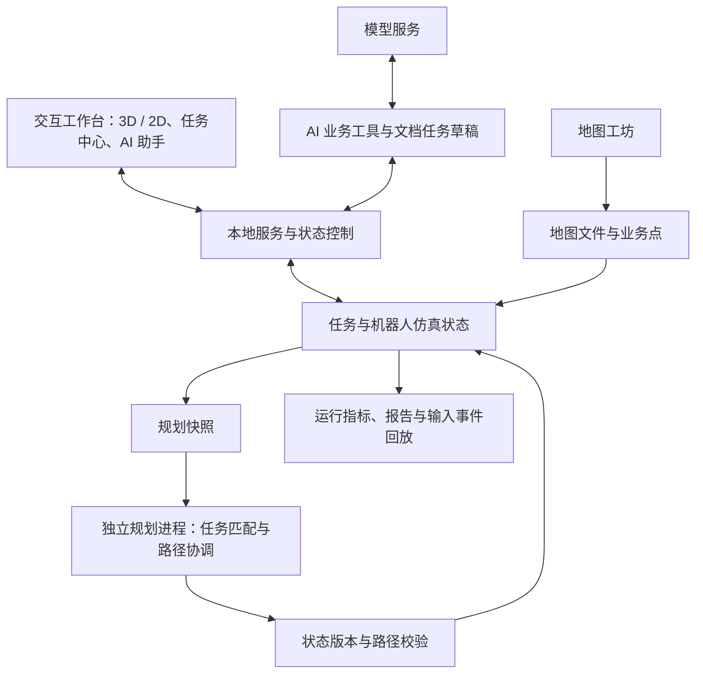

# AWCS · 智能仓储协同调度系统

**Agent-Assisted Warehouse Coordination System**

**以自然语言连接仓储业务，以多机器人协同完成搬运。**

AWCS 是面向仓储搬运场景的智能协同调度仿真项目。系统将 AI 业务助手、任务分配、多机器人路径规划和 3D/2D 可视化整合到同一工作台，支持从自然语言下单、文档提取任务，到机器人取货、配送和执行结果查看的完整流程。

项目以可交互的仓储仿真呈现技术方案，适用于竞赛演示、调度策略验证和仓库布局实验。当前版本为 **v0.4_preview**。

## 项目背景

仓储搬运涉及持续到达的任务、不同紧急程度的订单，以及共享通道中的多台机器人。任务分配和路线规划需要共同回答三个问题：

- **任务如何表达？** 将人员指令或文档中的搬运需求转化为明确的取货点、配送点和优先级。
- **任务交给谁？** 在紧急程度、机器人状态和人工指定等约束下选择执行者。
- **机器人如何协同？** 在共享道路上协调通行、等待、装卸和停车，避免空间与时间冲突。

AWCS 围绕这些问题搭建业务与算法相连接的实验环境，让调度过程可操作、可观察、可记录。

## 核心功能与项目亮点

### 1. 面向业务操作的 AI 助手

用户可以通过自然语言查询任务和机器人状态、创建搬运任务、提升优先级、取消未装货任务、指定执行机器人、设置软偏好或复制已有任务。助手通过十类业务工具读取真实状态并提交操作，由程序检查地点、任务阶段和调度约束。

**AI 负责理解业务意图，确定性调度模块负责分配与路线计算。** 机器人路线由规划器生成，助手的操作结果与仿真状态关联展示。

可在演示中尝试：

> “查看当前可用的取货点和配送点。”
>
> “从刚才查到的一个取货点搬运到一个配送点，设为紧急任务。”
>
> “查看刚创建任务的执行状态。”

具体地点与任务编号以当前地图和查询结果为准；信息缺失或存在歧义时，需要补充确认。

### 2. 兼顾优先级与执行约束的任务分配

系统将搬运建模为“取货 → 装货 → 配送 → 卸货”的阶段流程，支持 1～5 级任务，5 级为紧急任务。

- 使用匈牙利算法实现多项式时间匹配，按任务等级逐级优先，再考虑可满足的机器人软偏好、预计完成代价和到达顺序。
- 支持人工指定与自动分配，明确区分必须遵守的指定关系和允许调整的软偏好。
- 支持紧急任务对未装货普通任务的调度抢占；装卸过程保持连续，载货机器人先完成当前交付。
- 取消操作仅适用于装货前的任务，业务约束由程序统一检查。

### 3. 有时间预算的多机器人路径协调

默认规划模式结合 **SIPP 安全区间搜索、时空预约、规划顺序调整与局部 CBS 冲突修复**，为多台机器人协调取送及停车路线。

规划结果经过独立检查，覆盖障碍穿越、非法移动、同格占用、对向换位和装卸连续性。规划在独立进程中执行，通过状态版本核对结果；预算内未取得可执行的安全方案时，系统暂停并保留任务，便于调整参数或重试。

调试窗口还提供 CBS 基准模式、滚动窗口模式，以及拥堵估计和有限候选评估两类任务—路径联动选项。其中滚动窗口为实验能力。

### 4. 同步可视化与运行指标

主窗口同步展示 3D 仓库、2D 地图、机器人、任务状态和路线，支持视角旋转、缩放与平移。调试窗口共享同一仿真状态，可暂停、单步、调整速度、添加任务和切换实验配置。

系统记录任务完成数、总移动距离、等待步数、平均任务完成时间、规划耗时和恢复尝试等指标，并支持保存运行报告与场景输入事件，便于复盘与比较。

### 5. 从文档到任务的人工核对流程

支持读取 **MD、TXT 和 DOCX**，提取搬运需求并形成带来源信息的任务草稿。用户核对地点、等级和数量后选择确认，任务才进入调度流程。

上传、分析和编辑草稿均不会创建任务。缺失地点需要按当前地图补齐；货物数量与搬运任务数量分别处理。每次确认最多创建 20 项任务。

### 6. 独立地图工坊

地图工坊提供“生成 → 预览 → 校验 → 规划试运行 → 保存 → 导出”的布局实验流程，支持规整、L 形、T 形、U 形、庭院、组合房间和随机组合七类轮廓。

可以配置地图尺寸、机器人容量、货架、通道、障碍和随机种子，并管理本地地图库。地图工坊可独立启动，生成与校验无需 AI 服务。

## 系统架构



| 层次 | 实现与职责 |
| --- | --- |
| 交互展示 | HTML、CSS、JavaScript、Three.js；3D/2D 同步展示与任务交互 |
| 桌面与服务 | Python、本机 HTTP 服务、pywebview / WebView2；支持桌面和浏览器入口 |
| 业务智能 | 模型服务接入、业务工具调用、文档解析、任务草稿与确认创建 |
| 协同调度 | 任务匹配、时空预约、SIPP、CBS 局部修复、异步规划与结果校验 |
| 场景与记录 | JSON 地图、参数与种子、地图工坊、运行报告和输入事件回放 |

前端资源随项目提供，无需 Node 构建或外部 CDN。基础仿真和地图工坊可离线运行；AI 功能需要连接所配置的模型服务。

## 快速开始

### 环境要求

- **Windows 10/11 x64**。
- **Python 3.14 x64**，包含 pip；项目已有开发验证环境为 Python 3.14.5。
- 桌面窗口需要 **Microsoft Edge WebView2 Runtime**；也可使用浏览器模式。
- 首次安装 Python 依赖需要联网。AI 功能另需模型服务地址、模型 ID 和 API Key。

### 安装与启动

1. 双击 [setup.bat](setup.bat)，创建 `.venv` 并安装依赖。
2. 双击 [launch.bat](launch.bat)，启动仓储仿真，默认使用 `fleet_64x64` 地图和 16 台机器人。
3. 在主窗口打开“调试窗口”，控制仿真、添加任务并查看运行指标。

也可在项目根目录打开 PowerShell：

```powershell
python -m venv .venv
.\.venv\Scripts\python.exe -m pip install -r requirements.txt
.\launch.bat
```

依赖版本固定在 [requirements.txt](requirements.txt)：`pywebview`、`pythonnet`、`httpx`。

### 浏览器模式

```powershell
.\.venv\Scripts\python.exe main.py --browser --debug-window --map fleet_64x64 --robots 16 --paused
```

该命令打开主页面与调试页面，并以暂停状态启动。关闭浏览器页后，在启动终端按 `Ctrl+C` 结束服务。

### AI 配置与文档导入

在主窗口“AI 设置”中填写 API 地址、模型 ID 和 Key。默认地址为 `https://api.deepseek.com`；其他服务需兼容项目使用的聊天、流式响应及工具调用协议，具体可用性取决于服务实现。

导入文档时，按以下流程操作：

**AI 助手 → 添加文件 → 分析文件 → 核对来源与草稿 → 补齐并选择 → 确认创建**。

也可以将一个 MD、TXT 或 DOCX 文件拖入 AI 助手聊天区域，松开后读取附件，再按上述流程分析和确认。一次只支持一个文件；正在处理请求时需等待完成后再导入。

MD/TXT 文件上限为 1 MiB，DOCX 上限为 10 MiB，提取正文上限为 20,000 字符。DOCX 支持正文与表格，图片不做 OCR；存在未处理修订时，应先处理修订后再导入。超限内容会提示处理。

## 建议的竞赛演示流程

| 步骤 | 操作 | 展示重点 |
| --- | --- | --- |
| 1. 场景总览 | 启动默认 16 台机器人场景，展示 3D/2D 与任务中心 | 仓库布局、机器人状态与任务流的统一呈现 |
| 2. 协同搬运 | 在调试窗口添加任务并运行，结合单步观察取货、装卸和通行 | 多机器人分配、路线协调与执行阶段 |
| 3. 紧急插单 | 添加 5 级任务，观察分配变化和任务阶段约束 | 优先级机制与业务规则 |
| 4. 智能交互 | 配置 AI，查询真实地点并下单，再导入文档核对草稿 | 自然语言操作与文档任务提取 |
| 5. 布局实验 | 打开地图工坊，生成、校验、试运行并导出新地图 | 场景扩展与布局验证 |
| 6. 结果复盘 | 查看指标并保存记录 | 调度过程与结果的可观察性 |

切换地图、机器人数量或重置场景会清空当前任务并保持暂停，需要保留演示记录时请先保存。未配置 AI 时，可以完成手动下单、协同仿真、地图生成和指标展示。

## 地图与实验配置

项目内置 9 张地图，覆盖规整仓库、不规则仓库、L 形、庭院和组合房间等布局。

| 配置 | 用途 |
| --- | --- |
| `fleet_64x64` · 16 台 | 默认演示场景，适合展示任务、路线和交互流程 |
| `fleet_64x64` / `irregular_96x64` · 16～32 台 | 主要目标规模，用于比较布局和任务流下的调度表现 |
| `experimental_128x96` · 64 台 | 实验配置，需要结合任务、规划预算与硬件实测 |

32 台不规则仓库启动示例：

```powershell
.\.venv\Scripts\python.exe main.py --map irregular_96x64 --robots 32 --paused
```

64 台实验配置示例：

```powershell
.\.venv\Scripts\python.exe main.py --map experimental_128x96 --robots 64 --plan-seconds 8 --paused
```

机器人数量受所选地图的登记容量限制。直接执行 `main.py` 的默认值为 `warehouse` 地图和 3 台机器人；竞赛演示建议使用 `launch.bat` 或显式指定参数。

### 生成并使用新地图

双击 [launch_map_studio.bat](launch_map_studio.bat)，或在仿真调试窗口点击“地图工坊 ↗”。也可独立执行：

```powershell
python map_studio/main.py
```

地图工坊本身使用 Python 标准库，可在未安装桌面依赖时运行。

1. 设置轮廓、尺寸、容量和种子，点击“生成并预览”。
2. 检查静态校验结果，先从 16 台开始“规划试运行”，再验证目标规模。
3. 填写名称与新文件标识，点击“保存为新地图”。
4. 点击“导出到 v0.4 地图列表”，将地图写入 `maps/`。
5. 回到仿真调试窗口，“刷新列表 → 选择地图和数量 → 应用并重置”。

地图预览不会改变当前仿真；保存和导出不覆盖同名文件。更多参数与地图库操作见 [地图工坊说明](map_studio/README.md)。

## 运行记录与实验复现

调试窗口支持“保存记录”和“加载记录”。保存后，`outputs/last_run.json` 包含任务、机器人、指标和有限长度的位置轨迹；`outputs/last_scenario.json` 包含地图快照、种子、规划参数和输入事件。

加载记录采用**输入事件回放**，从场景初始状态重新执行事件。比较实验时应同时记录地图、机器人数量、任务流、随机种子、规划模式、预算和运行环境；有时间预算的规划结果可能受机器性能影响。

命令行也支持无界面运行并打印指标：

```powershell
.\.venv\Scripts\python.exe main.py --headless --map fleet_64x64 --robots 16 --ticks 1200
```

任务时长与等待时间以仿真时间步计，移动距离以网格计。评估时应结合这些指标及运行条件判断表现，地图容量不能直接等同于吞吐能力。

## 项目结构

```text
.
├─ main.py                   仿真启动入口
├─ controller.py             命令处理与运行控制
├─ simulation.py             任务、机器人与仿真状态
├─ scheduler.py              任务匹配与停车分配
├─ server.py                 本机服务与前后端接口
├─ persistence.py            场景回放与运行报告
├─ ai/                       模型接入、会话与业务工具
├─ task_imports/             文档提取、任务草稿与确认创建
├─ coordination/             任务分配、规划协调与独立进程
├─ planning/                 路径搜索、时空预约与安全校验
├─ map_support/              地图生成支持与拓扑分析
├─ map_studio/               独立地图工坊与地图库管理
├─ frontend/                 交互页面、3D 资源与图标
├─ maps/                     仿真地图
├─ scenarios/                示例回放场景
├─ setup.bat                 安装依赖
├─ launch.bat                启动默认演示场景
├─ launch_map_studio.bat      启动地图工坊
├─ requirements.txt          Python 依赖
└─ THIRD_PARTY.md             第三方归属与算法研究来源
```

## 当前范围与后续方向

当前系统采用静态四邻域网格、单格机器人和简化装卸模型，提供仓储搬运的交互式仿真。真实库存与商品载重、动态封路、电池与故障转运、ROS/SLAM 以及实体机器人控制尚未纳入实现。

算法效果受地图拓扑、任务密度、机器人规模和规划预算影响。静态连通性通过或有限试运行成功，仅说明对应检查或场景通过；系统不承诺任意任务流下的全局最优与长期无死锁。64 台配置和滚动窗口模式仍需进一步实验评估。

后续可围绕更系统的基准评测、复杂业务约束、动态场景和实体机器人接口继续扩展。

## 数据与第三方说明

- 模型 Key 默认仅在本次运行保留；选择“记住密钥”后写入当前 Windows 用户的凭据管理器。
- 文档在本机读取，提取文本、本次说明和地点表发送给所配置的模型服务；原始 DOCX 二进制不发送给模型。任务草稿仍需人工核对。
- `local_settings.json`、`outputs/` 和 `map_studio/library/` 按使用情况创建；分享源码前应检查本机配置、运行记录和个人数据。
- 算法研究来源、MovingAI 地图归属与第三方资源说明见 [THIRD_PARTY.md](THIRD_PARTY.md)；Three.js 等前端资源的许可证随 `frontend/vendor/` 提供。
